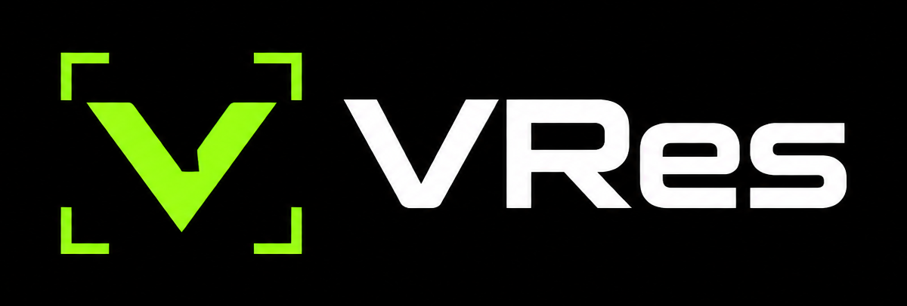
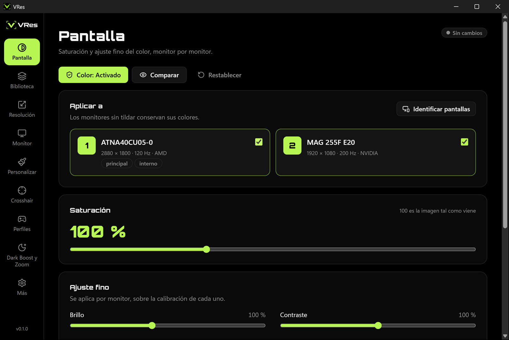

<div align="center">



**Display tuning for gaming. Free, local and open source.**

Saturation up to 300%, digital vibrance, stretched resolution, crosshair, per-game profiles, Dark Boost and zoom, in a single Windows app. No account, no subscription and no telemetry.

[](https://github.com/Gxnza48/VRes/actions/workflows/ci.yml)
[](https://github.com/Gxnza48/VRes/releases)
[](LICENSE)
[](https://discord.gg/aG2ByWDHfG)
[](https://vresolution.vercel.app)


[Español](README.md) · **English**



</div>

> [!IMPORTANT]
> **VRes is in alpha.** The **Display** tab (saturation up to 300%, NVIDIA and AMD driver vibrance, and per-monitor fine tuning) the **Resolution** tab (stretched, HDR and a native ↔ stretched hotkey) and the **Crosshair** tab (shapes, your own image, hidden from captures and a show/hide hotkey) are here, with their safety net, and features land phase by phase. See the [feature table](#features) and the [roadmap](docs/ROADMAP.md) (in Spanish).

---

## What VRes is

VRes changes **how your monitor shows the picture**: more color, more contrast where it matters, the resolution you prefer and an always-visible crosshair. It never touches the game: it uses the same Windows and graphics-driver facilities that the NVIDIA and AMD control panels use.

It is built for the Latin-American gaming community: **truly free** (no paid plans, nothing locked), works **offline**, needs no account, and ships in **Spanish, English and Portuguese**.

## Features

| Feature | Status | Version |
|---|---|---|
| App foundation: system tray, automatic updates, Spanish / English / Portuguese | ✅ Available | v0.1 |
| **Display:** 0–300% saturation and per-monitor fine tuning (brightness, contrast, gamma, temperature, shadows, highlights, blacks, whites and tints) | ✅ Available | v0.1 |
| **Resolution:** stretched 4:3, 5:4 and 16:10, refresh rate and HDR, with automatic rollback and a native ↔ stretched hotkey | ✅ Available | v0.2 |
| **Digital vibrance** through the driver, per monitor: NVIDIA and AMD (emulated on Intel) | ✅ Available | v0.3 |
| **Crosshair** overlay: shapes by parts, colors, your own image, any monitor, hidden from captures, saved crosshairs and a show/hide hotkey | ✅ Available | v0.4 – v0.9.1 |
| **Looks & Library:** own per-game looks, local library, share codes, color depth, color-blindness aids, eye care and quick adjust from the tray | ✅ Available | v0.5 |
| **Per-game profiles:** Fortnite, VALORANT, CS2, Apex Legends, Rust, Rainbow Six Siege and any other game; look and crosshair while in front, resolution while the game is open | ✅ Available | v0.6 |
| **Dark Boost & Zoom** while holding (or toggling) a key or a mouse button, Mouse 4 and 5 included; they ship disarmed | ✅ Available | v0.7 |
| **Customize:** theme, accent color, interface size and your own background (image or GIF). Diagnostic report without personal data | ✅ Available | v0.8 – v0.9 |
| Per-GPU custom resolutions and a signed installer | 🗓 Planned | v1.0 |

## Install

1. Go to [**Releases**](https://github.com/Gxnza48/VRes/releases/latest) and download `VRes_x.y.z_x64-setup.exe`.
2. Run it. It installs for your user only and **does not need administrator rights**.
3. VRes lives in the system tray. New versions install from **More → Updates**.

**Requirements:** Windows 10 (version 2004 or later) or 11, 64-bit. The installer adds WebView2 if it's missing.

> [!NOTE]
> **If Windows says "Windows protected your PC":** click **More info** and then **Run anyway**. It happens because the installer is **not signed yet** and is new, not because it has a virus: Microsoft Defender finds nothing in it. If your browser says the file "isn't commonly downloaded", choose **Keep**.
>
> Each release publishes `SHA256SUMS.txt`, and you can always [build VRes yourself](#build-from-source).

## How it works

VRes works in three layers, all in user mode and **without touching the game**:

| Layer | What it adjusts | How | Scope |
|---|---|---|---|
| **Color matrix** | Saturation > 100%, hue, color-blindness aids, Dark Boost | Windows full-screen color effect (Magnification API) | Whole desktop |
| **Gamma ramp** | Gamma, brightness, contrast, temperature, shadows, highlights | Graphics card gamma table (`SetDeviceGammaRamp`) | Per monitor |
| **Driver** | Digital vibrance | Each vendor's API (NVIDIA NVAPI, AMD ADL) | Per monitor |

The **crosshair** is a transparent window that ignores clicks; **zoom** uses the Windows magnifier; **resolution** changes are temporary (Windows reverts them if anything goes wrong) and always ask for confirmation; **profiles** detect which program is in the foreground by its name.

What VRes does **not** do: inject code, read or write any game's memory, install drivers or services, use keyboard or mouse hooks, or open the game's process.

Technical details (in Spanish): [docs/ARQUITECTURA.md](docs/ARQUITECTURA.md) and [docs/MOTOR-DE-COLOR.md](docs/MOTOR-DE-COLOR.md).

## Compatibility

| | NVIDIA | AMD | Intel |
|---|:-:|:-:|:-:|
| 0–300% saturation (Windows matrix) | ✅ | ✅ | ✅ |
| Per-monitor fine tuning (gamma ramp) | ✅ | ✅ | ✅ |
| Driver vibrance | ✅ | ✅ | 🧪 emulated in software |
| Custom resolutions | v1.0 | v1.0 | 🧪 |

- **Game display mode:** we recommend **borderless windowed**. In **exclusive full screen** the game bypasses the Windows color layer: matrix saturation, the crosshair and zoom don't show there, but driver vibrance and gamma ramps do. VRes detects it and tells you.
- **HDR:** with HDR on, Windows doesn't guarantee gamma-ramp behavior and the matrix is limited to safe adjustments. VRes marks those layers as *limited* and explains why.
- **Multiple monitors:** the Windows color matrix is shared by the whole desktop. If you untick a monitor, VRes pauses global effects and tells you; brightness, gamma, temperature and vibrance are per monitor.
- **Laptops with two GPUs:** VRes detects which GPU drives each screen and uses the right driver for each.

Real-hardware results: [docs/hardware/RESULTADOS.md](docs/hardware/RESULTADOS.md). Tried VRes on your PC? [Tell us how it went](https://github.com/Gxnza48/VRes/issues/new?template=hardware_report.yml).

## Anti-cheat, honestly

VRes doesn't interact with games and uses the same API families as GPU control panels and Windows color filters. **Even so, there is no guarantee:** no anti-cheat publishes an allow-list, and publishers judge by **effect**, not method. Epic says third-party software is used at your own risk; Riot lists zoom tools among unfair advantages; FACEIT bans any software giving an unfair advantage (and lists VibranceGUI, another vibrance tool, as safe). The **crosshair**, **zoom** and **Dark Boost** may count as cheating depending on the game or tournament, so they ship turned off with a warning. Check your game's rules. Details: [docs/ANTI-CHEAT.md](docs/ANTI-CHEAT.md).

## Keeping your display safe

- **Closing VRes restores everything** (colors, vibrance and resolution).
- **Emergency shortcut:** `Ctrl + Alt + Shift + R` resets the display at any time, even with the window closed.
- A **"VRes — Reset display"** Start-menu shortcut, plus `vres.exe --reset` and `vres-cli reset`.
- **If VRes is killed** (power loss, forced close), it saves the original values before changing anything and restores them on the next start.
- **Resolution changes ask for confirmation** and revert on their own otherwise.

## Privacy

No account, no data collection, nothing sent to any server. The only network connection is the update check on GitHub, and it can be turned off.

## Build from source

**Requirements:** Windows 10/11 x64, Node.js 22+, stable Rust (MSVC) and Visual Studio Build Tools 2022 with "Desktop development with C++".

```powershell
git clone https://github.com/Gxnza48/VRes.git
cd VRes
powershell -ExecutionPolicy Bypass -File scripts\setup-dev.ps1   # recommended, especially inside OneDrive
npm ci
npm run tauri dev
```

Tests: `cargo test --workspace`, `npx vitest --run`, `npm run lint`, `npm run check:i18n`. More in [docs/DESARROLLO.md](docs/DESARROLLO.md).

## Community

Join the **[VRes Discord](https://discord.gg/aG2ByWDHfG)**: release news, help, looks and crosshairs to share, and ideas.

## Contributing

Hardware compatibility reports, translations, presets, ideas and code are all welcome. Read [CONTRIBUTING.md](CONTRIBUTING.md) first, especially the *clean-room* rule. Security issues: [SECURITY.md](SECURITY.md).

## License

[GPL-3.0-or-later](LICENSE).

## Credits and disclaimer

VRes is an independent community project, not affiliated with any graphics-card vendor, game publisher or other product. Trademarks belong to their owners. Built with [Tauri](https://tauri.app), [Rust](https://www.rust-lang.org) and [React](https://react.dev); third-party licenses are in [THIRD-PARTY-NOTICES.md](THIRD-PARTY-NOTICES.md).
