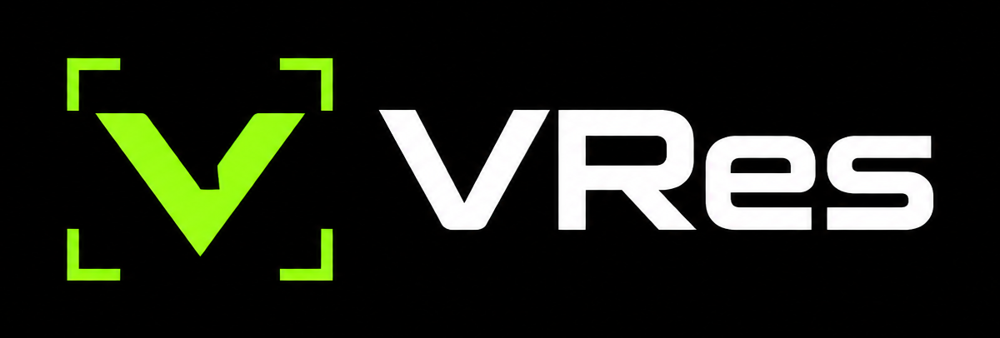
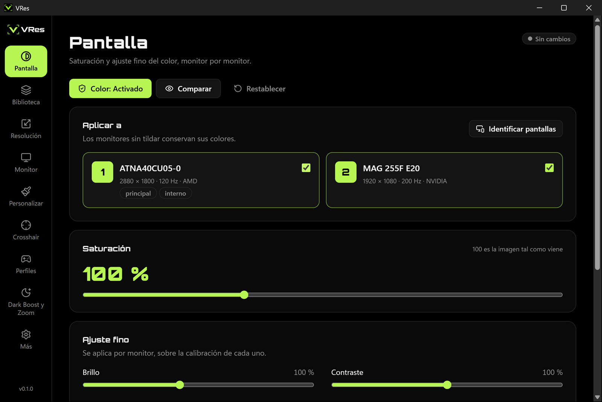

<div align="center">



**Ajustes de pantalla para gaming. Gratis, local y de código abierto.**

Saturación hasta 300 %, vibrance digital, resolución estirada, crosshair, perfiles por juego, Dark Boost y zoom, en una sola app para Windows. Sin cuenta, sin suscripción y sin telemetría.

[](https://github.com/Gxnza48/VRes/actions/workflows/ci.yml)
[](https://github.com/Gxnza48/VRes/releases)
[](LICENSE)

[](https://discord.gg/aG2ByWDHfG)
[](https://vresolution.vercel.app)

**Español** · [English](README.en.md)



</div>

> [!IMPORTANT]
> **VRes está en alfa.** Ya están las pestañas **Pantalla** (saturación hasta 300 %, vibrance por driver NVIDIA y AMD, y ajuste fino por monitor) **Resolución** (estirada, HDR y atajo nativa ↔ estirada) y **Crosshair** (formas, imagen propia, oculto en capturas y atajo para mostrarlo u ocultarlo), con su red de seguridad, y se van sumando funciones por fases. Mira en qué está cada una en la [tabla de funciones](#funciones) y en la [hoja de ruta](docs/ROADMAP.md).

---

## Qué es VRes

VRes cambia **cómo tu monitor muestra la imagen**: más color, más contraste donde importa, la resolución que prefieres y un crosshair siempre visible. No toca el juego: trabaja con las mismas herramientas de Windows y de los drivers de video que usan los paneles de NVIDIA y AMD.

Está pensado para la comunidad gamer de Latinoamérica: es **gratis de verdad** (sin planes pagos ni funciones bloqueadas), funciona **sin conexión**, no pide cuenta, y viene en **español, inglés y portugués**.

## Funciones

| Función | Estado | Versión |
|---|---|---|
| Base de la app: bandeja del sistema, actualizaciones automáticas, español / inglés / portugués | ✅ Disponible | v0.1 |
| **Pantalla:** saturación de 0 a 300 % y ajuste fino por monitor (brillo, contraste, gamma, temperatura, sombras, altas luces, negros, blancos y tintes) | ✅ Disponible | v0.1 |
| **Resolución:** estirada 4:3, 5:4 y 16:10, Hz y HDR, con vuelta atrás automática y atajo nativa ↔ estirada | ✅ Disponible | v0.2 |
| **Vibrance digital** por driver, monitor por monitor: NVIDIA y AMD (en Intel, emulada) | ✅ Disponible | v0.3 |
| **Crosshair** superpuesto: formas por partes, colores, imagen propia, monitor a elección, oculto en capturas, guardados y atajo para mostrarlo u ocultarlo | ✅ Disponible | v0.4 – v0.9.1 |
| **Looks y Biblioteca:** looks propios por juego, biblioteca local, códigos para compartir, profundidad de color, ayudas para daltonismo, cuidado visual y ajuste rápido desde la bandeja | ✅ Disponible | v0.5 |
| **Perfiles por juego:** Fortnite, VALORANT, CS2, Apex Legends, Rust y Rainbow Six Siege, y cualquier otro; look y crosshair al frente, resolución mientras el juego está abierto | ✅ Disponible | v0.6 |
| **Dark Boost y Zoom** manteniendo (o alternando) una tecla o un botón del mouse, incluidos Mouse 4 y 5; vienen desarmados | ✅ Disponible | v0.7 |
| **Personalizar:** tema, color de acento, tamaño de la interfaz y fondo propio (imagen o GIF). Reporte de diagnóstico sin datos personales | ✅ Disponible | v0.8 – v0.9 |
| Resoluciones personalizadas por GPU e instalador firmado | 🗓 Planeado | v1.0 |

## Por qué VRes

- **Gratis y libre.** Licencia GPL-3.0: cualquiera puede leer, auditar y mejorar el código, y nadie puede cerrarlo para venderlo.
- **Sin cuenta y sin telemetría.** La única conexión a internet es la búsqueda de actualizaciones en GitHub, y la puedes apagar.
- **Todo es reversible.** Al cerrar VRes la pantalla vuelve a como estaba; si algo falla, hay un atajo de emergencia (ver [La seguridad de tu pantalla](#la-seguridad-de-tu-pantalla)).
- **Liviano mientras juegas.** VRes vive en la bandeja; al cerrar la ventana libera la memoria de la interfaz.
- **Transparente.** Esta página explica exactamente [cómo funciona](#cómo-funciona-sin-misterio) y [qué no hace](#anti-cheat-con-honestidad).

## Descarga e instalación

1. Entra a [**Releases**](https://github.com/Gxnza48/VRes/releases/latest) y descarga `VRes_x.y.z_x64-setup.exe`.
2. Ejecútalo. Se instala solo para tu usuario y **no pide permisos de administrador**.
3. VRes queda en la bandeja del sistema (junto al reloj). Las versiones nuevas se instalan desde **Más → Actualizaciones**.

**Requisitos:** Windows 10 (versión 2004 o posterior) u 11, de 64 bits. El instalador agrega WebView2 si falta (Windows 11 ya lo trae).

> [!NOTE]
> **Si Windows dice "Windows protegió tu PC":** toca **Más información** y después **Ejecutar de todas formas**. Pasa porque el instalador **todavía no está firmado** y es nuevo, no porque tenga un virus: Microsoft Defender no detecta nada en él. Si el navegador dice que el archivo "no se descarga habitualmente", elige **Conservar**.
>
> Cada release publica `SHA256SUMS.txt` para verificar el archivo, y también puedes [compilar VRes tú mismo](#compilar-desde-el-código).

## Cómo funciona, sin misterio

VRes trabaja en tres capas, todas en modo usuario y **sin tocar el juego**:

| Capa | Qué ajusta | Cómo | Alcance |
|---|---|---|---|
| **Matriz de color** | Saturación > 100 %, tono, ayudas para daltonismo, Dark Boost | Filtro de color de pantalla completa de Windows (Magnification API) | Todo el escritorio |
| **Rampa de gamma** | Gamma, brillo, contraste, temperatura, sombras, altas luces | Tabla de gamma de la placa de video (`SetDeviceGammaRamp`) | Cada monitor |
| **Driver** | Vibrance digital | API pública de cada fabricante (NVIDIA NVAPI, AMD ADL) | Cada monitor |

Además: el **crosshair** es una ventana transparente que no recibe clics; el **zoom** usa la lupa de Windows; la **resolución** se cambia de forma temporal (Windows la devuelve sola si algo sale mal) y siempre pide confirmación; los **perfiles** detectan qué programa está en primer plano por su nombre.

Lo que VRes **no** hace: no inyecta código, no lee ni escribe la memoria de ningún juego, no instala drivers ni servicios, no usa hooks de teclado o mouse, y no abre el proceso del juego.

Los detalles técnicos están en [docs/ARQUITECTURA.md](docs/ARQUITECTURA.md) y [docs/MOTOR-DE-COLOR.md](docs/MOTOR-DE-COLOR.md).

## Compatibilidad

| | NVIDIA | AMD | Intel |
|---|:-:|:-:|:-:|
| Saturación 0–300 % (matriz de Windows) | ✅ | ✅ | ✅ |
| Ajuste fino por monitor (rampa de gamma) | ✅ | ✅ | ✅ |
| Vibrance por driver | ✅ | ✅ | 🧪 se emula por software |
| Resoluciones personalizadas | v1.0 | v1.0 | 🧪 |

**Modo de pantalla del juego.** Recomendamos **ventana sin bordes** (*borderless*). En **pantalla completa exclusiva** el juego salta la capa de color de Windows: ahí no se ven la saturación de la matriz, el crosshair ni el zoom, pero sí el vibrance por driver y las rampas de gamma. VRes detecta ese modo y te avisa.

**HDR.** Con HDR activo, Windows no garantiza el comportamiento de las rampas de gamma y la matriz se limita a los ajustes que no rompen la imagen. VRes marca esas capas como *limitadas* y te dice por qué.

**Varios monitores.** La matriz de color de Windows es única para todo el escritorio. Si destildas un monitor, VRes pausa los efectos globales y te avisa; brillo, gamma, temperatura y vibrance sí son por monitor.

**Notebooks con dos placas de video.** VRes detecta qué GPU maneja cada pantalla y usa el driver que corresponde a cada una.

Los resultados de las pruebas en hardware real se publican en [docs/hardware/RESULTADOS.md](docs/hardware/RESULTADOS.md). Si probaste VRes en tu PC, [cuéntanos cómo te fue](https://github.com/Gxnza48/VRes/issues/new?template=hardware_report.yml).

## Anti-cheat, con honestidad

VRes no interactúa con los juegos (ver [lo que no hace](#cómo-funciona-sin-misterio)) y usa las mismas familias de APIs que los paneles de control de las placas de video y los filtros de color de Windows. **Aun así, no existe ninguna garantía:** ningún anti-cheat publica una lista de programas permitidos, y los editores juzgan por el **efecto**, no por el método:

- **Epic Games (Fortnite)** indica que no da soporte oficial al software de terceros y que su uso corre por cuenta de cada jugador. ([fuente](https://www.epicgames.com/help/en-US/c-Category_Fortnite/c-Trending_0/will-i-be-banned-if-i-use-third-party-software-with-fortnite-a000087567))
- **Riot Games (VALORANT)** menciona las herramientas de zoom entre las que dan una ventaja indebida. ([fuente](https://support.riotgames.com/en-us/riot/events/third-party-applications))
- **FACEIT** sanciona cualquier software que dé una ventaja injusta, y nombra a otra herramienta de vibrance (VibranceGUI) entre los programas seguros. ([fuente](https://support.faceit.com/hc/en-us/articles/360015788779))

El **crosshair**, el **zoom** y el **Dark Boost** pueden considerarse trampa según el juego o el torneo: por eso vienen apagados y muestran un aviso. Revisa las reglas de lo que juegas. El detalle por función está en [docs/ANTI-CHEAT.md](docs/ANTI-CHEAT.md).

## La seguridad de tu pantalla

- **Al cerrar VRes, todo vuelve a como estaba** (colores, vibrance y resolución).
- **Atajo de emergencia:** `Ctrl + Alt + Shift + R` restablece la pantalla en cualquier momento, aunque la ventana esté cerrada.
- **Acceso directo** "VRes — Restablecer pantalla" en el menú Inicio, y `vres.exe --reset` / `vres-cli reset` desde una terminal.
- **Si VRes se cierra de golpe** (corte de luz, cierre forzado), guarda los valores originales antes de cambiar nada y los restaura al abrirse de nuevo.
- **Los cambios de resolución piden confirmación:** si no confirmas, vuelve sola a la anterior.

## Privacidad

VRes no tiene cuenta, no recolecta datos y no envía nada a ningún servidor. La única conexión de red es la búsqueda de actualizaciones en GitHub, y se puede apagar.

Tus ajustes se guardan en tu PC (`%APPDATA%\io.github.gxnza48.vres`) y los registros, en `%LOCALAPPDATA%\io.github.gxnza48.vres\logs`.

## Preguntas frecuentes

<details>
<summary><b>¿Me pueden banear por usar VRes?</b></summary>

VRes no toca el juego, pero ningún programa puede garantizar qué decide un anti-cheat. Lee [Anti-cheat, con honestidad](#anti-cheat-con-honestidad) y las reglas de cada juego o torneo.
</details>

<details>
<summary><b>¿Por qué no se ve el cambio de color en pantalla completa?</b></summary>

En pantalla completa **exclusiva**, el juego le habla directo al monitor y salta la capa de color de Windows. Usa **ventana sin bordes**; el vibrance por driver sí funciona en exclusiva.
</details>

<details>
<summary><b>¿Por qué la saturación afecta a todos los monitores?</b></summary>

Windows aplica su filtro de color a todo el escritorio a la vez. Si quieres excluir un monitor, destíldalo: VRes pausa los efectos globales y aplica por monitor solo lo que se puede (brillo, gamma, temperatura y vibrance por driver).
</details>

<details>
<summary><b>¿Baja los FPS?</b></summary>

No procesa la imagen del juego: le pide a Windows o al driver que ajuste la salida. En reposo no consume CPU. La capa de color de Windows puede sumar latencia en algunos modos de pantalla; lo medimos y lo publicamos en las pruebas.
</details>

<details>
<summary><b>¿Por qué Windows dice que el editor es desconocido?</b></summary>

Porque el instalador todavía no tiene firma digital (está planeada). Puedes verificar el archivo con `SHA256SUMS.txt` o compilar VRes desde el código.
</details>

<details>
<summary><b>¿Cómo vuelvo todo a la normalidad?</b></summary>

Cierra VRes. Si algo quedó raro: `Ctrl + Alt + Shift + R`, el acceso directo "VRes — Restablecer pantalla" o `vres-cli reset`.
</details>

<details>
<summary><b>¿Es gratis de verdad?</b></summary>

Sí. Todas las funciones son gratis, sin cuenta, sin planes pagos y sin publicidad. El código es libre (GPL-3.0).
</details>

## Compilar desde el código

**Requisitos:** Windows 10/11 x64, [Node.js](https://nodejs.org) 22 o superior, [Rust](https://rustup.rs) estable (MSVC) y Visual Studio Build Tools 2022 con "Desarrollo para el escritorio con C++".

```powershell
git clone https://github.com/Gxnza48/VRes.git
cd VRes
# Recomendado (sobre todo si el repo está en OneDrive): compila fuera de la carpeta sincronizada.
powershell -ExecutionPolicy Bypass -File scripts\setup-dev.ps1
npm ci
npm run tauri dev
```

Pruebas y verificaciones:

```powershell
cargo test --workspace        # Rust (lógica de color, motor, CLI)
npx vitest --run              # interfaz
npm run lint
npm run check:i18n            # las traducciones están completas
```

Más detalles (estructura del repo, pruebas en hardware real, cómo publicar una versión) en [docs/DESARROLLO.md](docs/DESARROLLO.md).

```
crates/vres-core     lógica pura: modelos, matemática de color, planificador
crates/vres-win      acceso a Windows y a los drivers (el único código con `unsafe`)
crates/vres-engine   el motor que aplica, verifica y restaura los cambios
crates/vres-cli      herramienta de consola: diagnóstico, pruebas y restauración
src-tauri/           la app de escritorio (Tauri 2)
src/                 la interfaz (React + TypeScript)
```

## Hoja de ruta

VRes se construye por fases y cada una termina en una versión instalable. El plan completo, con lo que entra en cada fase, está en [docs/ROADMAP.md](docs/ROADMAP.md).

## Comunidad

Sumate al **[Discord de VRes](https://discord.gg/aG2ByWDHfG)**: novedades de cada versión, ayuda, looks y crosshairs para compartir, y propuestas.

## Contribuir

Toda ayuda suma: reportes de compatibilidad con tu hardware, traducciones, presets, ideas y código. Lee [CONTRIBUTING.md](CONTRIBUTING.md) antes de empezar (en especial la regla de *sala limpia*). Para vulnerabilidades, ver [SECURITY.md](SECURITY.md).

## Licencia

[GPL-3.0-or-later](LICENSE). Puedes usar, estudiar, modificar y compartir VRes; si distribuyes una versión modificada, tiene que seguir siendo libre bajo la misma licencia.

## Créditos y aviso

VRes es un proyecto independiente de la comunidad. No está afiliado a ningún fabricante de placas de video, editor de juegos ni otro producto. Las marcas mencionadas pertenecen a sus dueños. Hecho con [Tauri](https://tauri.app), [Rust](https://www.rust-lang.org) y [React](https://react.dev); las licencias de terceros están en [THIRD-PARTY-NOTICES.md](THIRD-PARTY-NOTICES.md).
